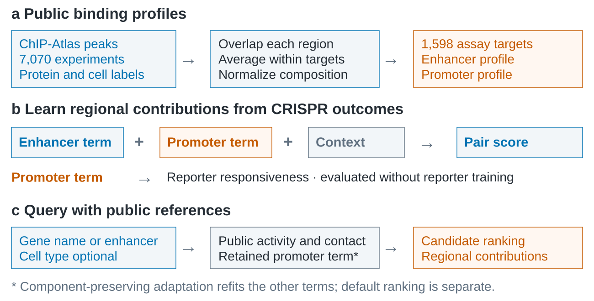

# Atlas-E2G

**Find candidate enhancers from a gene name, or candidate target genes from an enhancer coordinate.**

Atlas-E2G learns enhancer–gene relationships from CRISPR perturbation screens and protein-binding profiles built from ChIP-Atlas peaks. It assigns different contributions to enhancers and promoters. The pair score ranks functional links; the promoter contribution can be compared with responsiveness measured in reporter experiments.

For new queries, genome annotations, binding profiles and contact references are assembled automatically. An optional cell name selects measured public DNase accessibility. You do not need your own sequencing data or an experimental feature table.

The paper evaluates three connected uses:

| Evidence | Main result |
| --- | --- |
| Functional-pair prediction with full inputs | Five-cell weighted AP 0.670 versus 0.555 for published rE2G; 77 versus 65 observed positives in the top 100 |
| Regional biological information | Promoter correlation with reporter responsiveness 0.654; 0.648 when retaining the source component during public-input adaptation |
| Prediction from public inputs on predefined pairs | Matched public cell references increase non-K562 AP from 0.517 to 0.651, and distal AP from 0.243 to 0.609 |

These are retrospective evaluations. The [reproduction guide](docs/reproducibility.md) gives the matched controls and candidate definitions. In annotation-wide target queries, supported distance is a strong baseline; improved pair AP should not be read as superior open-query Top-k recovery.

## Reproduce the results

Use Python 3.11, preferably in a fresh virtual environment. From this folder:

~~~sh
python -m pip install -r requirements.txt
python run.py reproduce --from-saved
python run.py query-analysis --from-saved
python run.py figures
~~~

These commands work offline on a CPU. They write metrics to `output/reproduction/` and `output/query_analysis/`, and figures to `output/figures/`. Result figures are available as 600 dpi PNG, vector PDF and editable SVG. The method overview is an editable [SVG](docs/overview.svg).

The repository contains the processed training data, labels, overlap matrices, fitted parameters and saved predictions. No files from the authors' computers are needed. After installing dependencies, you can also inspect candidate retrieval offline with `python run.py query --gene MYC --candidates-only`. Scoring a new query additionally requires public references, acquired automatically as described below.

To refit from the included processed data, use `python run.py reproduce --output output/refitted`. The [reproduction guide](docs/reproducibility.md) also covers training stability and rebuilding features from public tracks.

## Query a gene or enhancer

For new predictions, install Node.js 20.19+ or 22.12+ and the contact reader once. Then specify the gene or enhancer to query:

~~~sh
npm ci --ignore-scripts
python run.py query --gene MYC
python run.py query --gene MYC --cell-type K562 --output output/MYC_K562
python run.py targets --enhancer chr8:127735000-127736000 --output output/enhancer
~~~

On the first uncached query, missing ChIP-Atlas peak files are downloaded automatically; the complete shared reference is about 6.3 GB. Completed files and computed overlaps are reused. Contact ranges and the requested accessibility track are also fetched and cached as needed; processed genome annotations and CAGE summaries are included. No manual feature assembly is needed. You can still run `python run.py download` to prepare peaks in advance. The [download guide](docs/reference_download.md) explains the sources and how to use another drive.

Gene queries return ranked regulatory regions within 500 kb of annotated TSSs by default. Enhancer queries consider all annotated promoter clusters within 1 Mb, without an assayed-gene list or expression filter, and return target-gene priorities. Both searches can extend to 5 Mb with `--radius 5000000`; for a broad gene search, also increase `--max-candidates` to avoid discarding distant regions at the candidate cap. Contact evidence affects scores within the search, not candidate discovery beyond its boundary. Coordinates use hg38. Cell type is optional for either query.

Open `ranked_pairs.csv` for a gene query, or `ranked_genes.csv` and `ranked_promoters.csv` for an enhancer query. Outputs separate raw pair scores, regional contributions and public transcription support. Public queries also return the retained source promoter contribution and its adapted score; these additional fields do not replace the default ranking. Scores guide candidate selection, not expression fold-change estimation. The [usage guide](docs/usage.md) explains each field, search settings and full-input prediction.

## Included files

- `atlas_e2g/` and `run.py`: reference acquisition, prediction, fitting, evaluation and plotting.
- `data/`: processed benchmarks, peak overlaps, annotations and public-reference accessions.
- `models/`: fitted full-input, public-input and component-preserving parameters.
- `reference_results/`: numerical results and predictions used in the paper.
- `examples/` and `docs/`: a pair-input example, instructions and the method overview.

Use `run.py` for all commands. Data origins and preprocessing are recorded in [SOURCES.json](data/SOURCES.json). Code is MIT licensed; public data retain their original terms. Please cite **Atlas-E2G learns transferable promoter responsiveness from endogenous enhancer perturbations** and the source studies.

## 中文速览

本项目从 ChIP-Atlas 蛋白结合谱和 CRISPR 功能标签学习增强子与启动子的不同贡献。安装依赖后，提供基因名即可检索候选增强子；提供增强子坐标即可检索附近全部注释靶基因；细胞名可选，无需自备测序数据。首次查询自动下载缺失的公共峰文件（完整参考约 6.3 GB），按需获取接触和可及性数据，后续复用缓存。默认配对排序、保留的启动子分量及公共转录支持分别输出。默认窗口为基因查询 500 kb、增强子查询 1 Mb，可扩大至 5 Mb；窗口外联系不会因存在三维接触而自动进入候选。完整使用说明见 [usage.md](docs/usage.md)。
